# Pato Criollo 🦆

Robot pato bípedo **hecho con piezas que se consiguen en MercadoLibre Argentina**, inspirado en el [XGO-Duck](https://github.com/LuwuDynamics/xgoduck_hardware) y el [Microduck de Pollen Robotics](https://github.com/pollen-robotics/microduck). El objetivo es que sea lo más barato posible.

Este repo tiene el **modelo 3D v0**: paramétrico, con las medidas reales de cada componente, masas calculadas, un modelo de simulación para MuJoCo y un **simulador que corre en el navegador**. Sirve para ver cómo queda, validar proporciones y torques, probar que se para y camina, y planificar el armado. **Las piezas definitivas para imprimir salen después de la fase 0**, cuando midamos los servos reales (ver [PLAN.md](PLAN.md)).

El aspecto sigue al pato original para que se reconozca enseguida: cabeza en forma de pan con un ojo redondo amarillo a cada lado, pico ancho y chato que abre como una tapa desde atrás, tronco cajita blanco y los servos del cuello y de las patas a la vista.

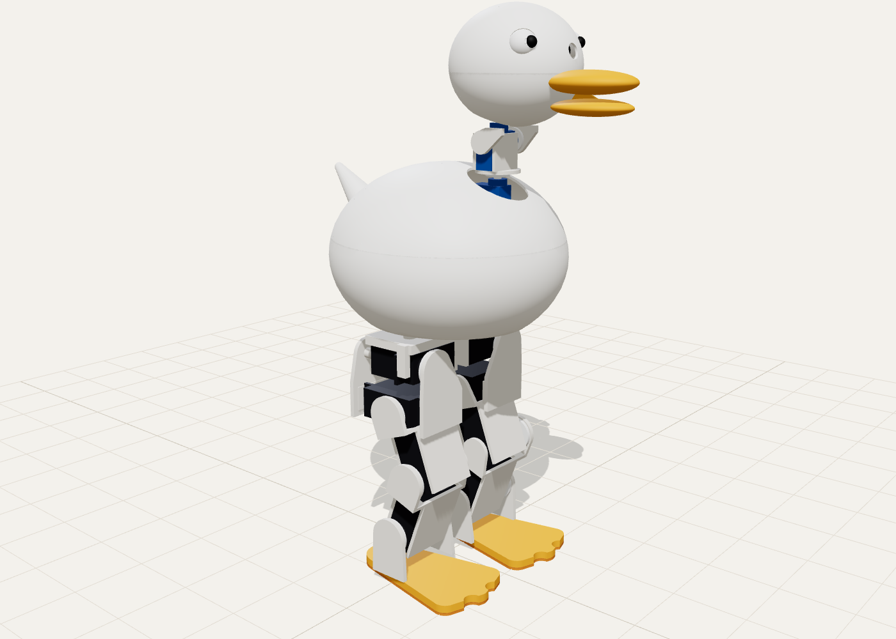

| Rayos X | Explotado | Saludo |
| --- | --- | --- |
| 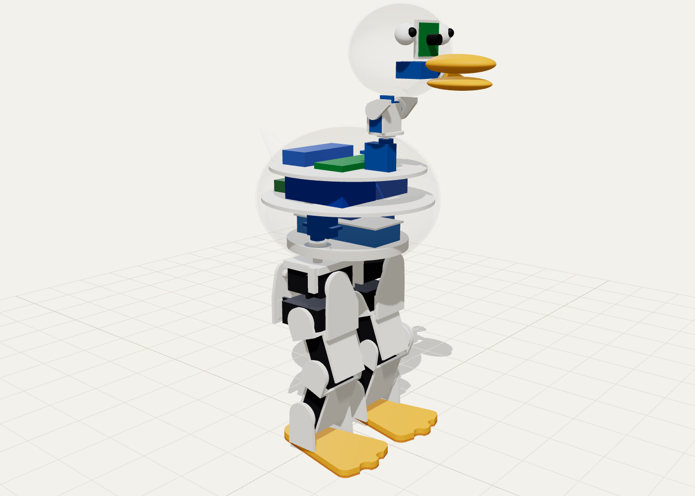 | 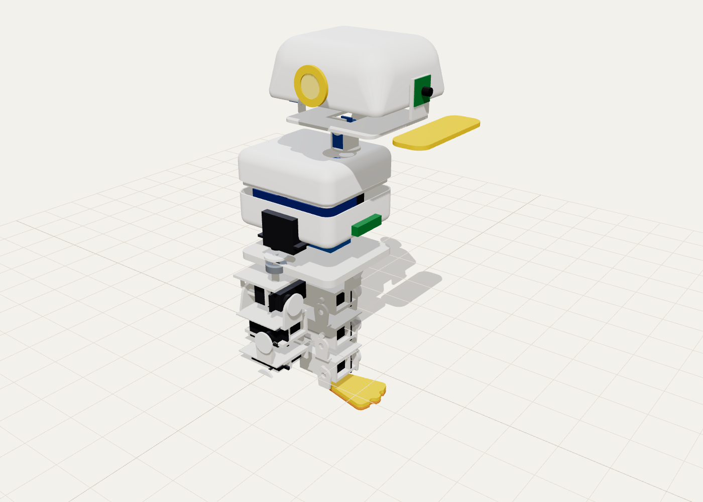 | 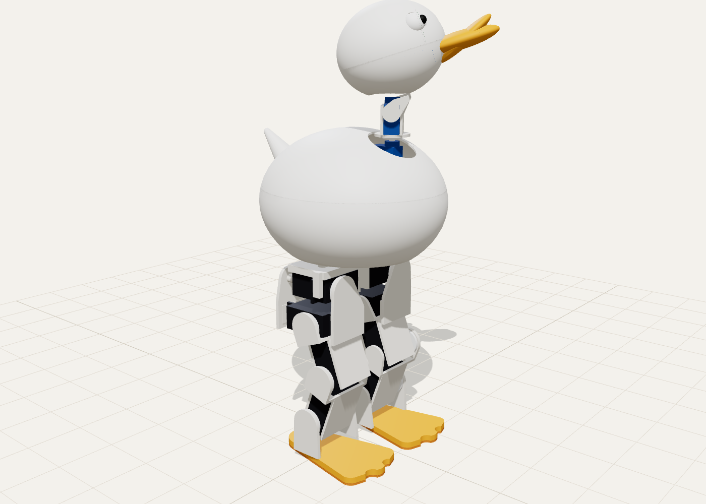 |

## Probarlo: simulador en el navegador

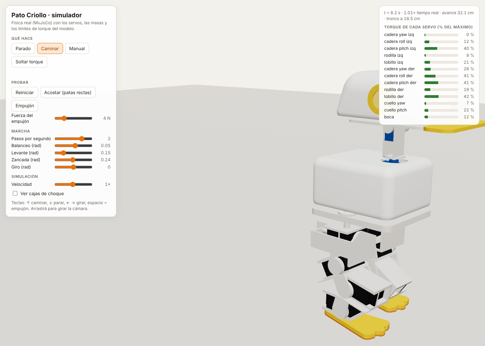

Descargá **[`salida/simulador.html`](salida/simulador.html)** (botón *Download raw file*, son 16 MB porque lleva el motor de física adentro) y abrilo con doble clic. Corre **MuJoCo** compilado a WebAssembly, con las masas e inercias del modelo y los servos como actuadores de posición con el torque máximo de cada uno. Funciona sin internet.

- **Parado / Caminar / Manual / Soltar torque.** Caminar usa una marcha programada a mano (osciladores); con *Manual* movés cada articulación con un deslizador.
- **Empujón** (barra espaciadora) para ver si se recupera. **Acostar** lo deja con las patas rectas para ver cómo se levanta... o no.
- Los deslizadores de marcha cambian frecuencia, balanceo, levante, zancada y giro en vivo. Teclas: ↑ caminar, ↓ parar, ← → girar.
- A la derecha, el **torque de cada servo en % de su máximo**, en tiempo real. Rojo = saturado.
- *Ver cajas de choque* muestra las formas que usa la física (una caja por eslabón).
- **Ejemplos de comportamiento** (sobre la marcha a mano, la misma lógica que después corre con la política entrenada): *Ir de A a B* recorre tres puntos marcados en el piso; *Seguir la pelota* centra con la cabeza una pelota roja que da vueltas, gira el cuerpo y se acerca (el recuadro "Lo que ve la cámara" muestra la imagen simulada de la cámara de la Pi); *Cuac mirando arriba* y *Mirar alrededor* son gestos de la cabeza; *Levantarlo* lo alza una mano 20 cm: recoge las patas, mira hacia arriba y, cuando lo apoyan, sigue.

Qué da hoy: se queda parado, aguanta un empujón de 4 N (0,15 s) sin dar un paso y camina derecho a unos 6 cm/s con la marcha a mano (51 cm en 8 s, a 2 pasos por segundo). Más rápido que eso, algún servo satura: el techo de esta mecánica con marcha a mano son unos 7 cm/s; la política entrenada tiene que superarlo aprovechando la zancada completa. Con 5 N o más se cae: para aguantar eso hay que dar un paso, y eso es lo que tiene que aprender la política RL. En el banco de pruebas con Python ([`sim/marcha.py`](sim/marcha.py)) las 108 combinaciones de marcha probadas caminan hacia adelante sin caerse, y las mejores aguantan empujones de 4 N en cualquier dirección mientras caminan.

## Ver el modelo en 3D

Descargá **[`salida/pato.html`](salida/pato.html)** y abrilo con doble clic en cualquier navegador. Es un único archivo de unos 2 MB que funciona sin internet.

Desde el visor podés:
- girar y hacer zoom;
- ver el robot armado, en rayos X (carcasa transparente), explotado o **paso a paso**;
- cambiar la pose: patas rectas, parado, cuclillas, saludo;
- pasar el puntero sobre cualquier pieza para ver qué es, cuánto pesa y en qué paso va.

## Qué tiene adentro

| | |
| --- | --- |
| Altura | **33,5 cm** parado, 33,9 cm con las patas rectas (el original mide unos 25 cm) |
| Masa estimada | **1,36 kg** (29 piezas impresas, 450 g de PLA y TPU; la cabeza completa pesa unos 150 g) |
| Servos | **10× MG996R** (cadera yaw, cadera roll, cadera pitch, rodilla y tobillo de cada pata) y **3× MG90S** (cuello yaw, cuello pitch, boca) |
| Patas | 5 articulaciones cada una. Los servos de cadera pitch, rodilla y tobillo van **acostados** (eje lateral) en una cuna impresa igual para los tres, alternando el lado del cuerpo (cadera atrás, rodilla adelante, tobillo atrás) para que al flexionar no se toquen: muslo y canilla miden 32 mm. El pie levanta hasta 11 mm del piso con la rodilla en su tope |
| Control | Raspberry Pi Zero 2 W a bordo, PCA9685 (PWM), 2× MCP3008 (lectura de los potenciómetros), MPU-6050 (IMU) |
| Cámara | Cámara de la Pi en la frente, con el lente justo arriba del pico |
| Energía | LiPo 2S de 1500 mAh, 2× XL4016 a 6,0 V (uno por pata), Mini560 de 5 V para la Pi |

### Torques (simulación MuJoCo, [`sim/torques.py`](sim/torques.py))

| Pose | Articulación más exigida | Uso del torque máximo |
| --- | --- | ---: |
| Parado (rodillas a 40°) | tobillo, 0,7 kg·cm | 6 % |
| Cuclillas (rodillas a 63°, el tope) | tobillo, 0,7 kg·cm | 6 % |
| En una pata, sin desplazar el cuerpo (peor caso) | cadera roll, 5,6 kg·cm | **51 %** |
| Caminando (marcha a mano a 6 cm/s, pico) | cadera pitch, 8,7 kg·cm | 79 % |
| Cabeza (cualquier pose) | boca y cuello pitch, 0,23 kg·cm | 10 % (MG90S) |

Al caminar, los picos suelen ser 2 a 3 veces el valor estático. **La cadera roll es el punto a vigilar.** Un paso normal desplaza el cuerpo sobre el pie de apoyo, así que exige menos que el peor caso. Tabla completa: [`salida/torques.md`](salida/torques.md).

Caminando en la simulación, con MG90S en la cadera yaw esos servos saturaban (100 % del torque) porque reciben toda la torsión de la pata apoyada. Por eso **la cadera yaw usa MG996R**: parados dentro del tronco, con las orejas atornilladas al estante A y el rulemán 608 tomando la carga radial. Con ese cambio, caminando ningún servo pasa del 79 % y la cadera yaw queda por debajo del 15 %.

### Que ninguna pieza choque con otra ([`cad/choques.py`](cad/choques.py))

El generador no solo arma el robot: lo mueve. `cad/choques.py` lleva cada pieza con la cinemática real a 72 poses (reposo, parado, cuclillas, 24 fases de un ciclo de marcha, cada articulación en sus dos topes, las dos caderas al tope a la vez, la cabeza girada con la boca abierta) y mide el volumen de intersección entre piezas de eslabones distintos. Hoy da **sin cruces** en las 72. Esa prueba fue la que corrigió el diseño anterior, donde los servos de la rodilla y el tobillo se cruzaban al flexionar.

De ahí salen los topes de cada articulación, que son los que usan el simulador y el entrenamiento:

| Articulación | Rango (rad) | Qué lo limita |
| --- | --- | --- |
| cadera yaw | −0,15 a +0,35 (punta hacia afuera) | la placa yaw con el soporte U de la otra pata |
| cadera roll | −0,09 (hacia adentro) a +0,25 | las dos patas entre sí |
| cadera pitch | −1,15 (muslo adelante) a +0,15 | la cuna del muslo con el servo roll |
| rodilla | −0,1 a +1,15 | la cuna de la canilla con el servo de la cadera |
| tobillo | −0,8 a +0,3 | el pie con la canilla |
| cuello yaw | ±1,5 | — |
| cuello pitch | −0,5 (arriba) a +0,6 (abajo) | el pico con la carcasa, con la cabeza girada |
| boca | 0 a 0,3 | ver abajo |

Dos combinaciones no se pueden impedir con topes y las tiene que evitar el controlador (el modelo de entrenamiento las simula como choque y las penaliza): las dos caderas cerradas hacia adentro **y** con las puntas giradas a la vez, y la boca abierta con la cabeza mirando abajo: con el cuello inclinado más de 0,45 rad la boca va cerrada, entre 0 y 0,45 abre hasta 0,15, y con la cabeza horizontal o hacia arriba abre entera (`BOCA_MAX` en `cad/pato.py`; el simulador lo aplica en modo manual).

## Cómo se arma

Las imágenes salen del mismo visor, en modo *Paso a paso*: en cada paso lo nuevo aparece en color y lo anterior, transparente.

**Antes de empezar, hay que modificar los servos:**
- Se abren y se suelda un cable al cursor (pin del medio) del potenciómetro interno, para que la Pi pueda leer la posición.
- Los MG996R de las patas van **con sus orejas**: la cuna impresa los sujeta por ahí (apoyos a ambos lados del cuerpo). Los dos de cadera yaw se atornillan por las orejas al estante A, desde abajo.
- A los MG90S del **cuello pitch** se les corta la oreja del lado opuesto al eje. Los del **cuello yaw** y la **boca** al revés: se corta la oreja del lado del eje.

| | |
| --- | --- |
| 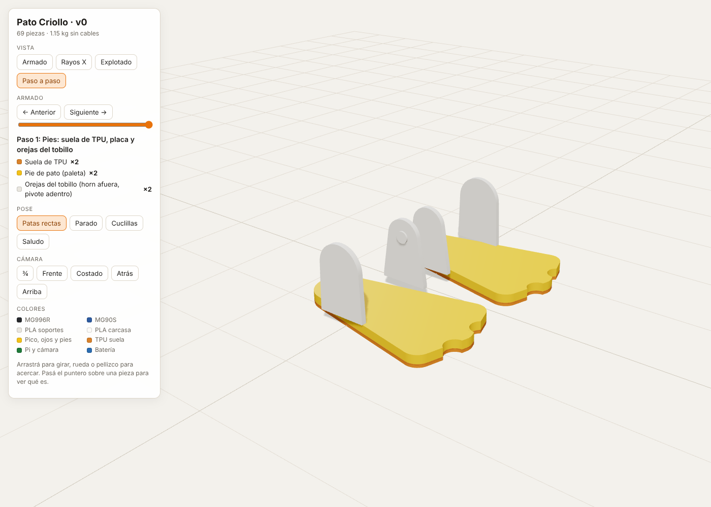 **1. Pies:** suela de TPU, paleta y orejas del tobillo. | 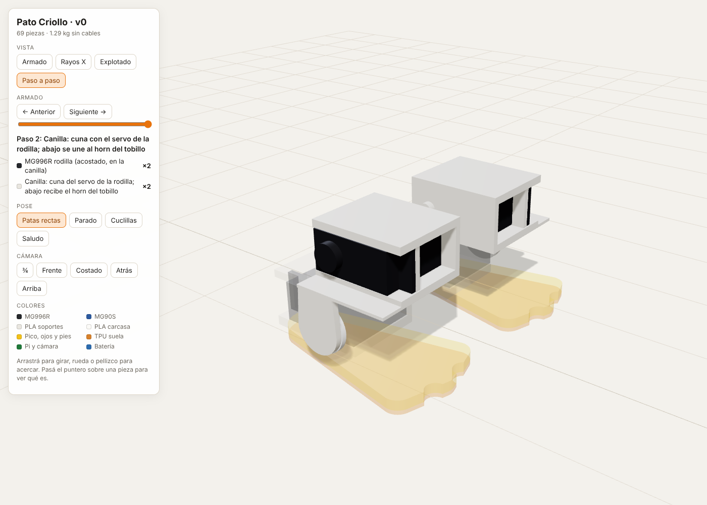 **2. Canilla:** cuna con el servo del tobillo acostado. Se une al pie. |
| 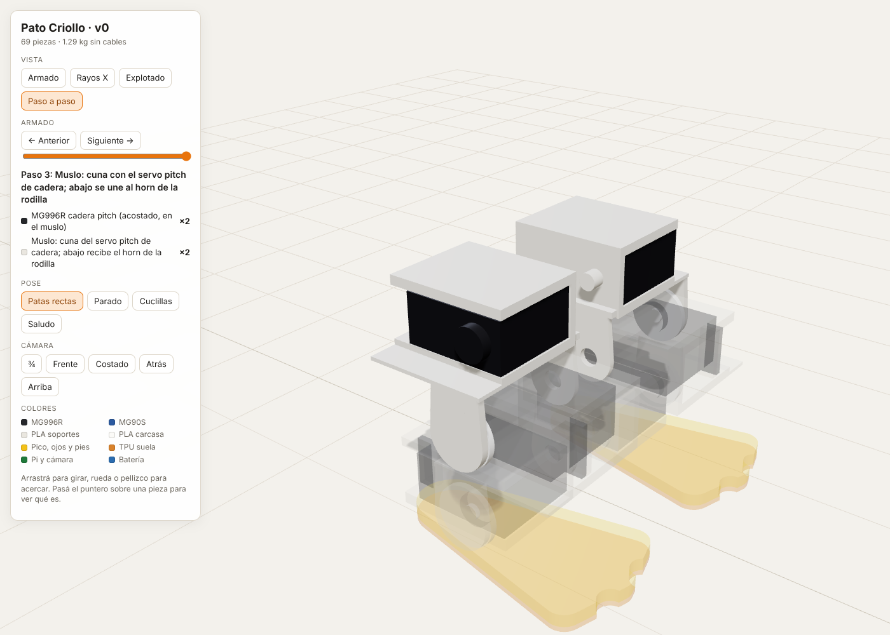 **3. Muslo:** cuna con el servo de la rodilla. Se une a la canilla. | 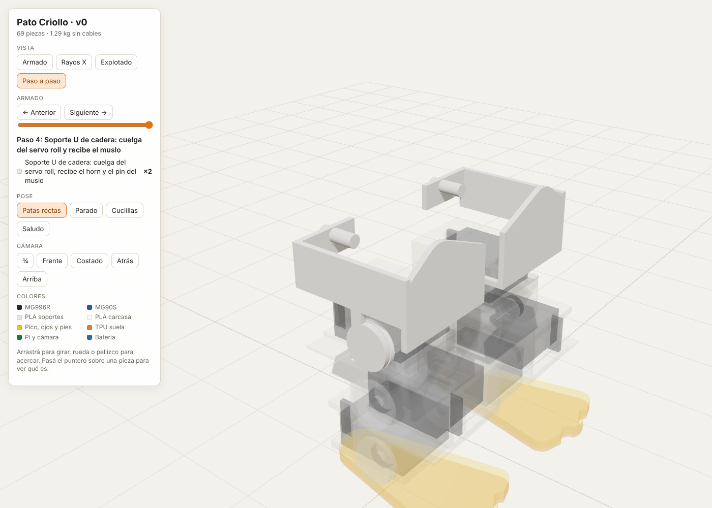 **4. Soporte U** de cadera: cuna con el servo pitch. Se une al muslo. |
| 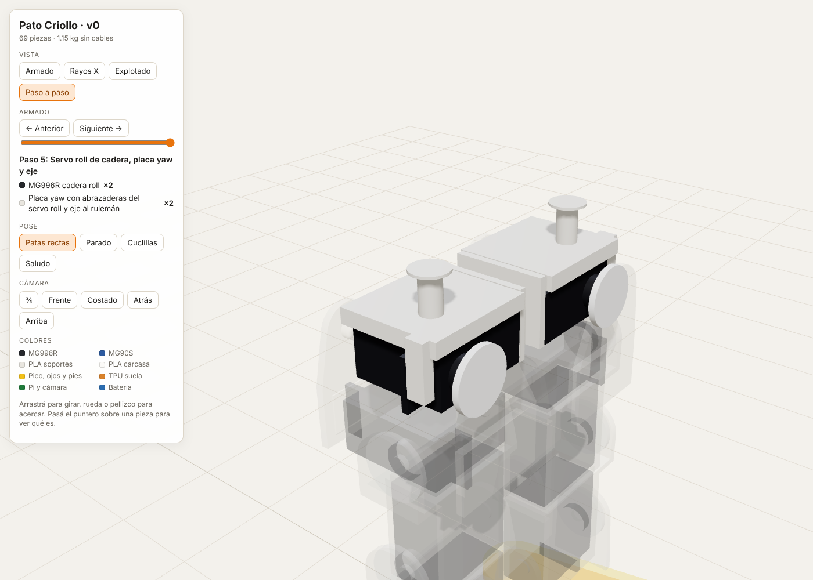 **5. Servo roll** de cadera, placa yaw y eje. | 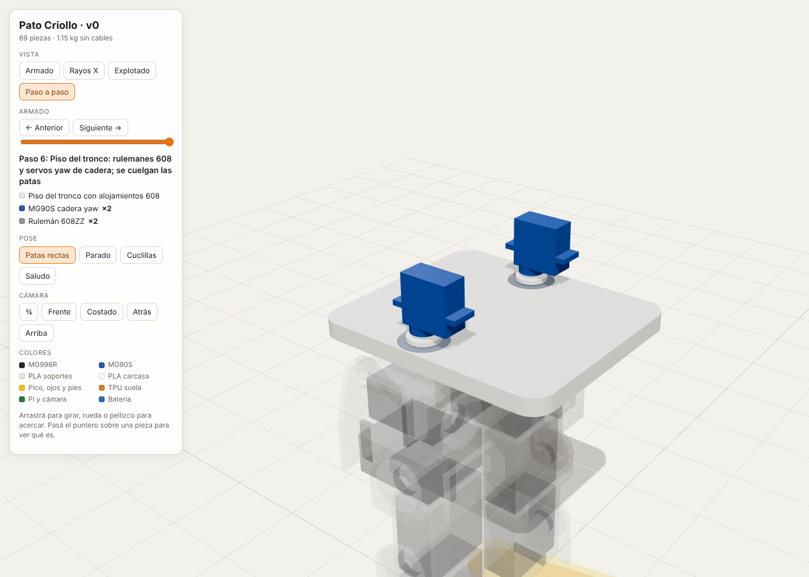 **6. Piso del tronco:** rulemanes 608 y servos yaw. Se cuelgan las patas. |
| 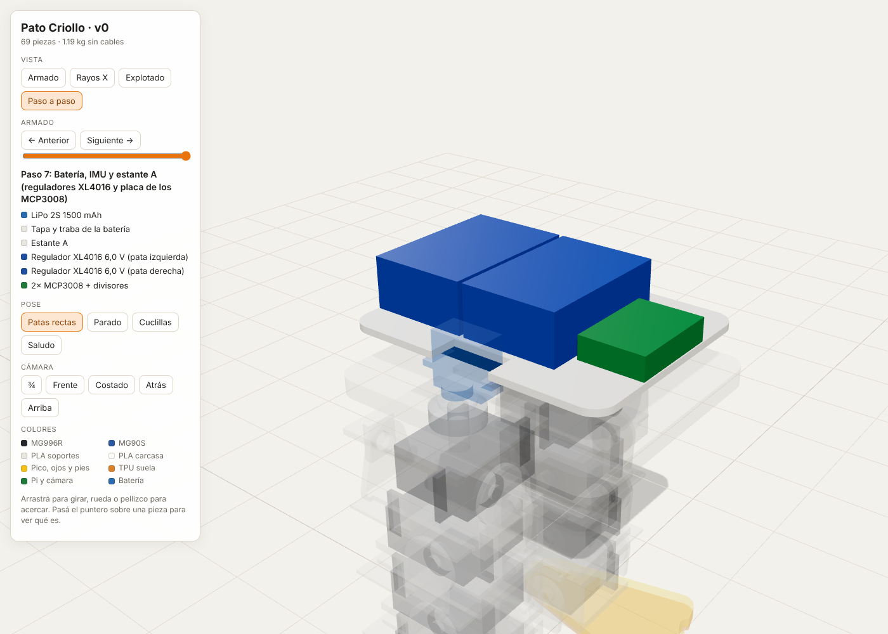 **7. Batería, IMU y estante A:** reguladores XL4016 y placa de los MCP3008. | 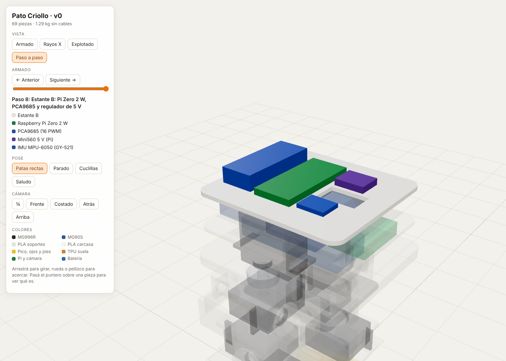 **8. Estante B:** Pi Zero 2 W, PCA9685 y regulador de 5 V. |
| 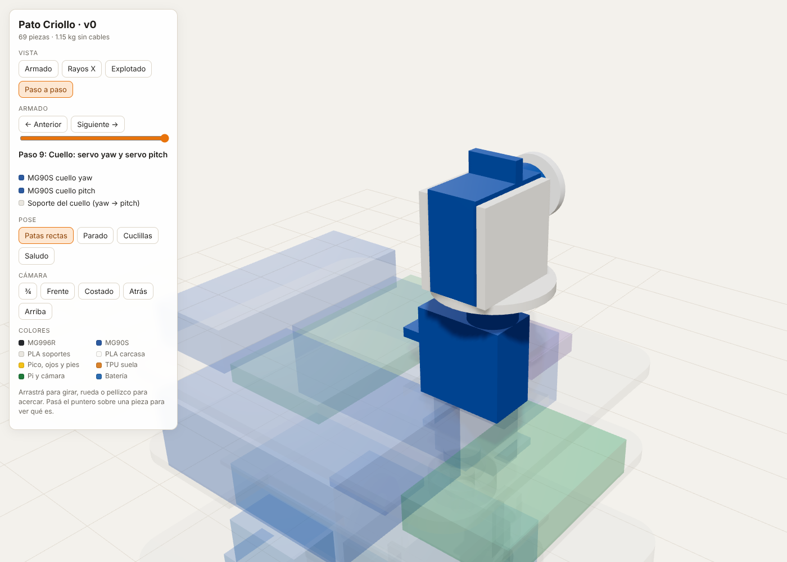 **9. Cuello:** servo yaw y servo pitch. | 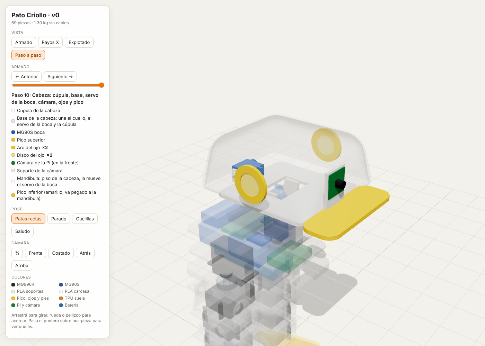 **10. Cabeza:** base, servo de la boca, mandíbula con el pico inferior, cámara, ojos, pico superior y cúpula. |
| 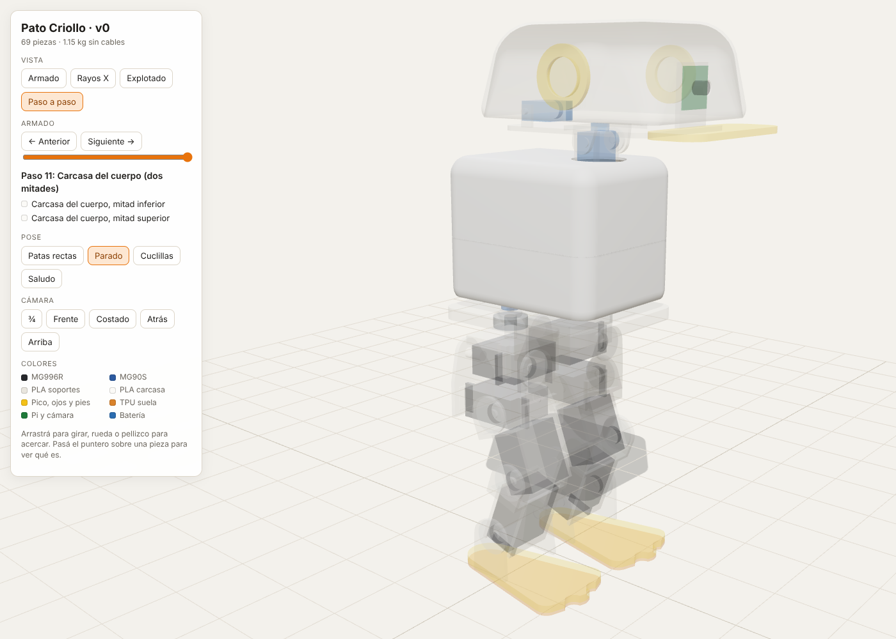 **11. Carcasa** del cuerpo (dos mitades). | 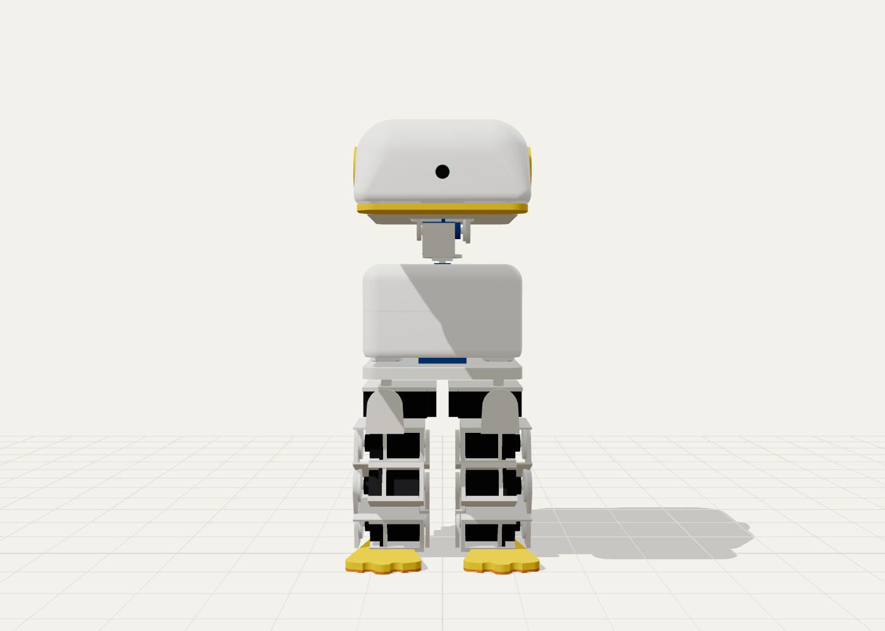 **Listo.** |

## Archivos

```
cad/componentes.py        medidas y masas reales: MG996R, MG90S, Pi Zero 2 W, LiPo, PCA9685, XL4016…
cad/pato.py               el robot completo: piezas, eslabones, articulaciones, pasos de armado
cad/choques.py            prueba de que ninguna pieza se cruza con otra en 72 poses (reposo, marcha, topes)
sim/torques.py            torques estáticos en MuJoCo contra el torque máximo de cada servo
sim/marcha.py             marcha programada a mano y barrido de parámetros (MuJoCo, Python)
rl/                       entrenamiento en la Mac: caminar y levantarse (PPO sobre MuJoCo), gestos de la cabeza, supervisor, ONNX; ver rl/README.md
visor/                    visor 3D y simulador (three.js + MuJoCo WASM), capturas y pruebas automáticas
salida/simulador.html     simulador físico autocontenido (16 MB, se abre con doble clic)
salida/pato.html          visor autocontenido (se abre con doble clic)
salida/pato.glb           modelo 3D con colores (sirve en Blender o en https://gltf-viewer.donmccurdy.com)
salida/piezas_impresas/   STL de las 31 piezas impresas (v0, todavía no para imprimir)
salida/mjcf/pato.xml      modelo MuJoCo con masas e inercias (mallas)
salida/mjcf/pato_sim.xml  el mismo con cajas de choque (una por pieza en las patas), es el que usa el simulador
salida/mjcf/pato_rl.xml   envolventes convexas de cada pieza con choques entre eslabones, para entrenar
salida/resumen.md         masa de cada pieza
docs/img/                 imágenes de este README
PLAN.md                   plan completo, fases y presupuesto
COMPRAS-FASE0.md          lista de compras de la fase 0 (banco de pruebas de servos)
```

## Regenerar todo

```bash
pip install manifold3d trimesh numpy mujoco        # probado con 3.5.4 / 5.2.0 / 2.5.3 / 3.17.0
python3 cad/pato.py                                # STL, GLB, MJCF, resumen
python3 sim/torques.py                             # tabla de torques
python3 sim/marcha.py                              # ¿camina? ¿con qué picos de torque?
python3 cad/choques.py                             # ¿se cruza alguna pieza con otra? (sale 1 si sí)
cd visor && npm install && npm run construir       # salida/pato.html y salida/simulador.html
node capturas.mjs && node probar_sim.mjs           # docs/img y prueba automática del simulador (Playwright)
```

Todo sale de `cad/pato.py`. Si cambiás una medida, como el largo del muslo o el servo, se regeneran juntos el 3D, la simulación y las imágenes.

## Estado y próximos pasos

- [x] Plan y presupuesto ([PLAN.md](PLAN.md))
- [x] Modelo 3D v0 con componentes reales, sin choques entre piezas (verificado por intersección de mallas)
- [x] Simulación de torques estáticos
- [x] Simulador en el navegador: se para, camina con marcha a mano, aguanta empujones
- [x] Entorno de entrenamiento para la Mac ([`rl/`](rl/README.md)): caminar (PPO en CPU), gestos de la cabeza programados, supervisor, exportación a ONNX. Levantarse del piso no es posible con estas patas (ver rl/README.md): queda pendiente decidir entre pedir ayuda al caer o agregar alas
- [ ] **Fase 0:** banco de pruebas de servos (soporte imprimible y scripts de medición para la Pi 4), [lista de compras](COMPRAS-FASE0.md)
- [ ] v1: piezas para imprimir con las medidas reales de los servos: agujeros, tornillería M3, tolerancias
- [ ] Entrenar la primera política de marcha en la Mac y probarla en el simulador; después reentrenar con el modelo identificado del servo

## Licencia

- Código (`cad/`, `sim/`, `visor/`): Apache-2.0.
- Diseño (modelos y STL): CC BY-SA 4.0.

Diseño propio: no usa archivos del XGO-Duck ni del Microduck; solo toma la idea y las proporciones como referencia.
